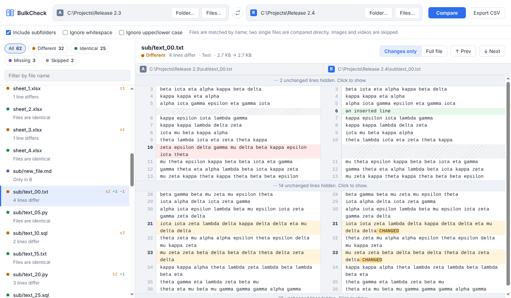

# BulkCheck

BulkCheck is a Windows desktop app that compares two folders, two files, or a set of files. Files with the same name are paired up, and for every pair you see whether it is identical or different. Click a file that differs to see the changed lines side by side, with line numbers and the content of each line.



## Features

- **Folders or files on each side**:
  - Two folders: files are matched by name (and by subfolder path), ignoring upper/lower case like Windows does.
  - One file on each side: the two files are compared directly, even if their names differ.
  - Several files on each side: files are matched by name.
  - Files against a folder: each file is compared with the same-named file in the folder, and the rest of the folder is ignored.
- **Handles 50+ files at once**: the summary list shows how many files are Different, Identical, Missing from one side, or Skipped.
- **Side-by-side view** with line numbers, changed lines highlighted and the exact changed characters marked. Use "Changes only" or "Full file", and jump between changes with **Prev / Next** (or the `P` / `N` keys).
- **Supported formats**
  - Any text file: `.txt`, `.csv`, `.json`, `.xml`, `.html`, `.log`, `.ini`, `.sql`, `.md`, source code and so on (UTF-8, UTF-16 and Windows-1252 encodings).
  - **PDF** (text of each page), **Word** `.docx` (one line per paragraph) and **Excel** `.xlsx` (one line per row, for each sheet).
  - Other files (for example `.zip`, `.exe`, `.doc`, `.xls`) are compared byte for byte and reported as identical or different.
  - **Images and videos are skipped.**
- **Options**: include subfolders, ignore whitespace, ignore upper/lower case. Windows (CRLF) and Unix (LF) line endings are always treated as the same.
- **Export CSV**: one row per changed line (file, change type, line in A, content in A, line in B, content in B). Opens directly in Excel.

## Install

Download one of these from the latest build:

- `BulkCheck-Setup-1.1.0.exe`: a normal installer with Start menu and desktop shortcuts.
- `BulkCheck-Portable-1.1.0.exe`: runs without installing, for example from a USB stick.

Works on Windows 10 and Windows 11 (64-bit). The app is not code-signed, so Windows SmartScreen may show "Windows protected your PC" the first time. Click **More info**, then **Run anyway**.

## Use

1. For side A and side B, click **Folder…** or **Files…** (or drag a folder or files onto each box).
2. Click **Compare** (or press `F5`).
3. Click any file in the list to see its differences. Use the chips at the top of the list to filter, or type in the filter box.
4. Click **Export CSV** to save a report.

## Develop

Requires Node.js 22.

```bash
npm install
npm start          # run the app
npm test           # run the tests
npm run dist:win   # build the installer and portable exe into dist/
```

Building the Windows installer on Linux needs Wine (64-bit and 32-bit). The GitHub Actions workflow in `.github/workflows/build.yml` builds both `.exe` files on Windows for every push and pull request and attaches them to the run as an artifact.

### Layout

- `src/core/`: comparison engine (file matching, text extraction, line diff, CSV). Has no Electron dependencies and is covered by `test/`.
- `src/main/`: Electron main process and preload bridge.
- `src/renderer/`: the app window (plain HTML, CSS and JavaScript).
